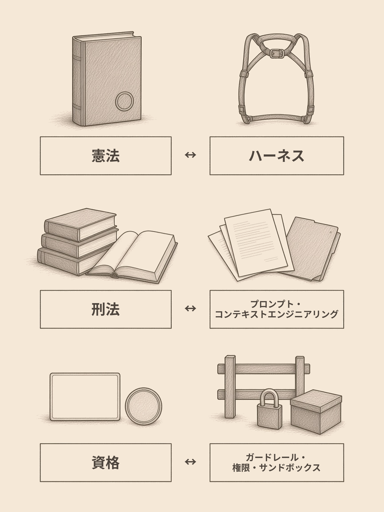

人の行動はルールで制限できても、思想では縛れません。AIはルールで縛ろうとしても、人と同じように、ときどき外れます。ただ、考え方を渡せば、それに沿って動かすことができる。そこが大きな違いな気がします。それがハーネス（AIに考え方を渡して、その方向に動かす仕組み）なのではないかと思いました。

## 人は、すでに持っている枠組みで生きている

ルールを法だと考えると、全部書かれた法はあったほうがいい。でも人間は法を全部頭に入れているわけではありません。もともと持っている基本的な枠組みで生きています。それがすでに持っている思想です。だから、それを上書きするような思想を押し付けて、行動を変えるのは難しい。人の考えを否定して動かそうとするより、否定せずに生きるほうが近い、と私は思っています。

## AIは、特定の思想を持たないようにできている

AIも同じです。人類が積み上げてきた、基本的な行動の規範は持っています。ただしそれは人類としての枠組みであって、特定の思想は理論的には持たないように設計されている、と私は思います。だから人とは違い、その上に目的や考え方を重ねることができる。最初からこちらで渡せるのです。

たとえば、人を殺してはいけない、とハーネスに定義するのではなく、個人は尊重されるべきもの、と書く。刑法第199条は「人を殺してはいけない」とは書いておらず、「人を殺した者は、死刑又は無期若しくは五年以上の拘禁刑に処する」と、罰だけを定めています（[e-Gov](https://laws.e-gov.go.jp/law/140AC0000000045/)）。その奥にある理念は憲法第13条の「すべて国民は、個人として尊重される」に近いと思います（[e-Gov](https://laws.e-gov.go.jp/law/321CONSTITUTION)）。刑罰で守るのが刑法で、理念を述べるのが憲法です。

## 細則は、スキルに書く

ハーネスには全体に対して基本的な理念を書く。それより細かい単位で、刑法や民法のようなものを定義していけばいい。たとえば、AIに運転を任せたとしましょう。それは定義するならDriving Agent Skills（運転を任せるときに渡す手順）のようなものかなと思います。個人は尊重されるべき、という理念がある。だから「他人に迷惑をかける運転をするな」「常に状況に気をつけろ」「事故を起こしたら真っ先に人命を優先しろ」と、そのなかに初めて書かれている感じです。

憲法に当たるのがハーネスで、全体に効く理念を書く場所です。刑法に当たるのがプロンプトやコンテキストエンジニアリング（その場面でだけ渡す指示）で、言葉で書いたものはときどき無視されることもあると思います。絶対に「できない」ようにしたいことは、資格のように、ガードレールや権限、サンドボックス（外から切り離した実行環境）といった仕組みで止めるのが、この三段階だと思っています。

だからハーネスはやってはいけないことのルールを書き出しまくる場所ではなく、基本的な行動の理念を定義する場所です。まずは、自分が毎日向かっているAIのハーネスに、あなたが思うあなたの行動理念を与えてみてください。
